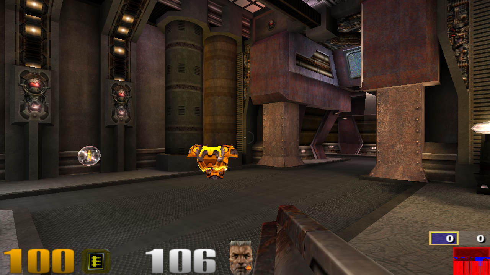
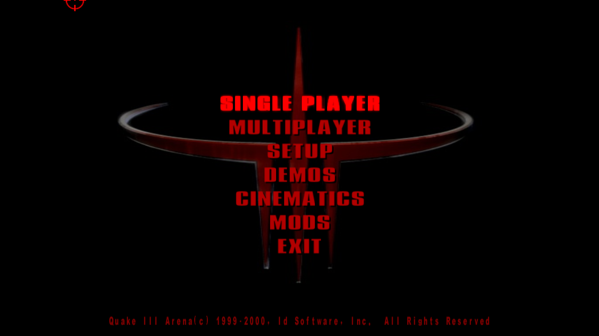
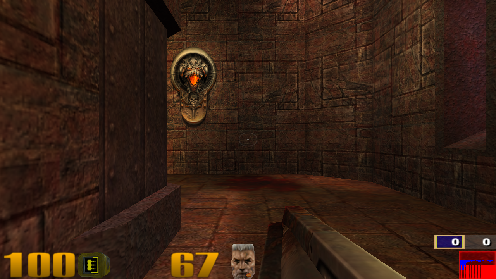

# MiniQuake3

[](LICENSE)
[](https://github.com/MiniLangProject)
[](#building)
[](#project-status)

MiniQuake3 is an unofficial Windows x64 port of the **Quake III Arena engine**
to [MiniLang](https://github.com/MiniLangProject). Its goal is to preserve the
original game's behavior, data formats and virtual-machine interfaces while
moving engine ownership into MiniLang.

The current playable path runs the original `ui`, `cgame` and `qagame` QVMs
against the MiniLang engine. Small native bridges provide Windows services,
rendering, audio and accelerated bytecode dispatch. It is a working preview,
not a finished replacement for every Quake III configuration or mod.

> [!IMPORTANT]
> MiniQuake3 does **not** include Quake III Arena game data. Supply your own
> legally obtained installation containing `baseq3/pak0.pk3`. Do not commit or
> redistribute the original PK3 archives with this repository.

## Screenshots

**`q3dm0` — the live game path, with the original world, weapon and HUD**

[](docs/screenshots/q3dm0.png)

| Original main menu | `q3dm1` arena |
| --- | --- |
| [](docs/screenshots/main-menu.png) | [](docs/screenshots/q3dm1.png) |

These are **real 1280×720 engine frames**, captured directly from the renderer
and stored as lossless PNGs. They are not desktop crops, upscaled previews or
generated artwork. Click an image to open it at full size. Capture commands,
source and binary hashes, renderer details and test limits are recorded in the
[capture manifest](docs/screenshots/capture-manifest.json).

## Highlights

- **Original game presentation:** the Quake III main menu, in-game HUD, view
  weapons and models, driven by the original QVM modules.
- **MiniLang engine systems:** PK3/DEFLATE loading, BSP geometry and collision,
  visibility, shader processing, client/server state and VM syscall handling.
- **Local arena play:** player movement, weapons, pickups, movers and bot
  integration exercised with original retail maps and game modules.
- **Two rendering paths:** a native OpenGL consumer for MiniLang-owned render
  batches and a software-rendering fallback.
- **Desktop integration:** keyboard and mouse input, configurable bindings
  transferred from the menu into a match, and continued operation when no
  audio output device is available. Full desktop persistence remains separate
  from the verified core correction set.
- **Evidence-oriented development:** original-source comparisons, compiled
  contracts, retail probes and reproducible screenshot captures.

## Project status

**Playable preview; active development.** The project contains extensive
engine and subsystem implementations, but source coverage is not the same as
complete behavioral parity.

| Area | What has been demonstrated |
| --- | --- |
| Windows build | Native EXE, Windows bridge DLLs and the three original QVM modules build with the published MiniLang 1.3.9 compiler. |
| Normal startup | Starting `MiniQuake3.exe` without arguments opens the original main menu using data beside the executable. |
| Retail game logic | Bot/player and scoreboard contracts have passed on `q3dm0` and `q3dm1`. |
| Graphical execution | An earlier `q3dm0` replay completed 300 frames; the README capture run separately exercises both pictured arenas. |
| Missing audio device | Initialization errors are caught; the menu and game continue without sound. |
| Audit core corrections | Strict original-source gates, wall-clock menu timing, honest frame percentiles, routing-cache bookkeeping and shared snapshot decoding have passed targeted Windows regressions and a full build. |
| Desktop lifecycle and persistence | A separate candidate exists; complete restart/map/menu/video and persistent-file integration is not yet accepted in this core change set. |
| Broader compatibility | Longer interactive sessions, multiplayer interoperability, hardware-specific behavior and complete 1:1 parity still need acceptance testing. |

The hosted Windows screenshot runs use **software rendering** and do not
establish hardware-accelerated performance or audible playback. Capture I/O is
also enabled: screenshot-run timings are not gameplay benchmarks. Earlier
screenshots are evidence for their recorded revision, not a new graphical
acceptance of the audit changes.

The [audit corrections and validation scope](docs/AUDIT_FIXES_2026-11-17.md),
[retail startup report](docs/verification/2026-11-16-ci-retail-start.json),
[parity audit](docs/PARITY_AUDIT.md),
[behavior audit](docs/BEHAVIOR_PARITY_AUDIT.md) and
[port plan](docs/PORTPLAN.md) track the wider project. Historical measurements
refer to their recorded compiler, source revision, machine and workload; they
must not be treated as results for every current build. The stricter
[source mapping inventory](docs/ORIGINAL_PARITY_REPORT.md) is not a completion
percentage: ABI mappings, native implementation, productive integration and
behavioral acceptance are distinct claims.

## Quick start

There is no versioned MiniQuake3 release yet. Use the source build below, or a
verified test-build archive. A build contains the engine and QVM modules, **not**
the proprietary game archives.

Place your original `pak0.pk3` and any installed update archives alongside the
executable in `baseq3`:

```text
build/
├── MiniQuake3.exe
├── *.dll
├── baseq3/
│   ├── pak0.pk3
│   └── pak1.pk3 ... pak8.pk3   # only the updates you actually have
└── qvms/
    ├── ui.qvm
    ├── cgame.qvm
    └── qagame.qvm
```

For example, from the repository root in PowerShell:

```powershell
$Quake3Root = "C:\Games\Quake III Arena"  # your existing installation
New-Item -ItemType Directory -Force .\build\baseq3 | Out-Null
Copy-Item "$Quake3Root\baseq3\pak*.pk3" .\build\baseq3\
& .\build\MiniQuake3.exe
```

The normal launch discovers data relative to the EXE, loads the installed
`pak*.pk3` priority chain, and opens the main menu before starting a map. Use
the QVMs produced by the build; do not substitute unrelated mod DLLs or QVMs.

## Building

### Fresh checkout: published compiler

Requirements: **Windows x64**, **Git**, **Python 3.10 or newer**, and **Visual
Studio / Build Tools with the Desktop development with C++ workload and the
Windows SDK**. Both x64 native bridges and the original x86 QVM build tools are
used. A working OpenGL driver is recommended for playing.

```powershell
git clone --recursive https://github.com/MiniLangProject/MiniQuake3.git
cd MiniQuake3
python scripts/build_release.py
```

For an existing checkout, initialize the original-source submodule first:

```powershell
git submodule update --init --recursive
```

`build_release.py` downloads the **pinned MiniLang 1.3.9 Windows package**,
checks both the package and compiler SHA-256, rebuilds the native bridges, and
builds the engine and original QVMs. The compiler and standard library are
isolated under `build/toolchains/`; the historical `artifacts/toolchain/` and
`docs/reference/toolchain.json` are **not overwritten**. Build input hashes and
logs are retained under `build/`.

The first build needs internet access for the compiler package. Game data is
not needed to compile and is never downloaded by this build script. The name
`build_release.py` describes the published-compiler build path, not a claim
that MiniQuake3 itself is a finished release.

### Historical frozen toolchain

Existing development setups with the exact frozen compiler and standard
library can continue to use:

```powershell
python scripts/build.py
```

That path verifies `artifacts/toolchain/` against the historical toolchain
profile. Those local artifacts are deliberately not tracked in Git. A fresh
checkout should use the isolated published-compiler path above rather than
regenerating the historical manifest with unrelated compiler inputs.

## Default controls

| Action | Default input |
| --- | --- |
| Move | `W`, `A`, `S`, `D` |
| Look | Mouse |
| Attack | Left mouse button |
| Zoom | Right mouse button |
| Jump | `Space` |
| Crouch | `Ctrl` or `C` |
| Select weapon | `1` through `9` |
| Previous / next weapon | `[` / `]` |
| Scoreboard | Hold `Tab` |
| Chat / team chat | `T` / `Y` |
| Menu | `Esc` |

The Controls menu provides rebinding and mouse settings, transferred from the
menu into the match. The audited normal desktop host does not yet provide the
complete persistent `q3config.cfg` and QVM write integration; its separate
candidate still needs end-to-end acceptance. Do not rely on settings surviving
a program restart in this core-only version. The current starter configuration
uses an inverted vertical mouse axis, which can be changed in Controls.

## Tests and verification

### Published-compiler smoke tests

After building and supplying `build/baseq3/pak0.pk3`:

```powershell
python scripts/test_default_launcher.py
python scripts/test_default_exe_startup.py
python scripts/build_release.py --source tests/singleplayer_bot_retail_probe.ml --output singleplayer_bot_retail_probe.exe
& .\build\singleplayer_bot_retail_probe.exe .\build\baseq3\pak0.pk3 .\build\qvms q3dm0
& .\build\singleplayer_bot_retail_probe.exe .\build\baseq3\pak0.pk3 .\build\qvms q3dm1
```

These are focused startup and retail-logic checks, not the full acceptance
suite. The no-argument startup test intentionally closes the menu after
observing it; it is not a manual playthrough or a normal menu-exit test.

### Audit core regressions

```powershell
python scripts/test_audit_inventory.py -v
python scripts/test_parity_inventory.py
python scripts/build_release.py --source tests/audit_timing_lru_contracts.ml --output audit_timing_lru_contracts.exe
& .\build\audit_timing_lru_contracts.exe
$env:MQ3_BUILD_TOOLCHAIN = "release"
python scripts/test_aas_routing_cache.py
Remove-Item Env:MQ3_BUILD_TOOLCHAIN
```

The original-source gate requires the pinned, clean submodule; missing
reference files cannot produce a passing result. The routing comparison uses
its documented scenario model. These checks do not measure GPU performance.

### Regenerate the README screenshots

The capture script uses the existing `MQ3_CAPTURE` framebuffer export, so a
small CI desktop cannot clip the image or hide part of the HUD:

```powershell
python -m pip install Pillow
python scripts/build_release.py --source tests/singleplayer_graphics_replay.ml --output singleplayer_graphics_replay.exe
python scripts/capture_readme.py
```

This captures the main menu and two arena views, checks that each replay
finishes, and writes PNGs plus provenance to `docs/screenshots/`. Raw capture
files and logs stay under `build/readme-captures/`. Only rendered screenshots
and metadata belong in Git, never the underlying retail assets.

### Full development suite

With the exact historical frozen toolchain already installed:

```powershell
python scripts/verify.py --data-root build
# Additional collision, patch and movement differential gates:
python scripts/verify.py --data-root build --extended
```

Many legacy gates invoke `scripts/build.py` themselves. A successful
published-compiler screenshot run does **not** mean this entire frozen-toolchain
suite was run, nor does it prove binary identity with an older build.

## Repository layout

| Path | Purpose |
| --- | --- |
| `src/` | MiniLang engine, client/server, gameplay, VM, renderer and platform logic |
| `native/` | Source-owned Windows, rendering, audio, networking and VM bridges |
| `tests/` | Compiled contracts, original-source comparisons and retail probes |
| `scripts/` | Build, verification and capture tools |
| `docs/` | Subsystem documentation, parity audits, evidence and screenshots |
| `Quake-III-Arena-original-source/` | Pinned id Software source submodule and original QVM tools |
| `PORT_LEDGER.json` | Detailed original-to-port source and symbol mapping |
| `build/`, `artifacts/` | Ignored local outputs and toolchains; not source distributions |

## Documentation

- [MiniDoc API reference](docs/api/markdown/README.md)
- [Audit corrections and validation scope](docs/AUDIT_FIXES_2026-11-17.md)
- [Port plan](docs/PORTPLAN.md) and [current parity audit](docs/PARITY_AUDIT.md)
- [Behavioral compatibility audit](docs/BEHAVIOR_PARITY_AUDIT.md)
- [Original-source mapping report](docs/ORIGINAL_PARITY_REPORT.md)
- [Playable preview](docs/PLAYABLE_PREVIEW.md) and [VM runtime](docs/VM_RUNTIME.md)
- [Upstream source provenance](docs/UPSTREAM.md)
- [Screenshot provenance](docs/screenshots/capture-manifest.json)

Some historical engineering documents are still in German. This README is
the English entry point; the detailed reports retain their original evidence
and revision-specific limitations.

## Related projects

[MiniQuake](https://github.com/MiniLangProject/MiniQuake) brings the original
Quake engine to MiniLang;
[MiniQuake2](https://github.com/MiniLangProject/MiniQuake2) targets Quake II.
All three belong to the
[MiniLang project](https://github.com/MiniLangProject), alongside the
[self-hosted compiler](https://github.com/MiniLangProject/MiniLangCompilerML).

## Legal and licensing

MiniQuake3 is independent and is not affiliated with or endorsed by id Software,
Bethesda Softworks or ZeniMax Media. Quake III Arena names and game assets
remain the property of their respective owners.

Quake III-derived port code is distributed under **GPL-2.0-or-later**. See
[LICENSE](LICENSE), [NOTICE.md](NOTICE.md), each file's license notices and the
original-source submodule for retained upstream and third-party terms. The
external MiniLang compiler and standard library retain their own licenses.
Original game data is not included or relicensed by this project.
